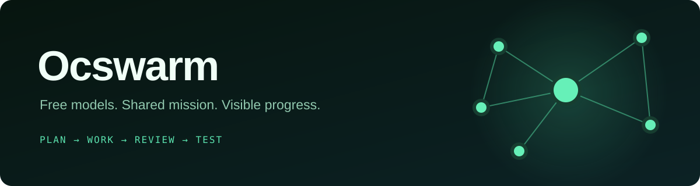
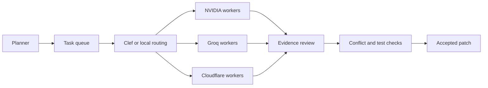

<p align="center"></p>

<p align="center">
  <a href="https://github.com/limidotu/ocswarm/actions"></a>
  
  
  
</p>

# Ocswarm

**A continuous swarm of free model workers, with a local dashboard and evidence checks.**

Ocswarm targets the Enter the Gungeon reconstruction. A planner creates tasks, workers edit private copies, and a reviewer checks each patch.
The supervisor merges owned files only after conflict and acceptance checks. The dashboard shows tasks, worker activity, model routes, and provider budgets.

**Give this repository to your AI agent:**

> Install Ocswarm from this repository. Read AGENTS.md and docs/INSTALL_AGENT.md first. Run the local checks. Ask me for missing credentials through the hidden prompt. Ask for my reconstruction folder and acceptance command. Start the swarm only when I request it. Use free provider plans only.

## Install

The supported host is **Windows 10 or 11**, with **Python 3.12+**, **Node.js 22+**, and **Git** on PATH.
The installer creates a Python environment, installs the tested OpenCode version, and builds the included dashboard.

```powershell
git clone https://github.com/limidotu/ocswarm.git
Set-Location ocswarm
powershell -NoProfile -ExecutionPolicy Bypass -File .\install.ps1
```

Save a free NVIDIA API key through the hidden prompt:

```powershell
.\.venv\Scripts\python.exe configure.py nvidia
```

NVIDIA is required for planning. Groq and Cloudflare add independent worker queues:

```powershell
.\.venv\Scripts\python.exe configure.py groq
.\.venv\Scripts\python.exe configure.py cloudflare
.\.venv\Scripts\python.exe ocswarm.py check
```

Get credentials from [NVIDIA](https://build.nvidia.com/), [Groq](https://console.groq.com/keys), and [Cloudflare](https://dash.cloudflare.com/).
Cloudflare needs an account ID and a token with Workers AI read and edit access for that account.
Keep each account on its free plan. Keys stay encrypted under your Windows account, outside this repository.
Workers receive the loopback gateway address instead of provider keys.

See [the agent install guide](docs/INSTALL_AGENT.md) for requirements, checks, and fixes.

## Start and stop

Ocswarm does not include game files or the Rust reconstruction. Supply your own reconstruction folder with `etg-rs/` and `rea-analysis/`.
Original evidence and the trusted method reader must already exist. See the install guide for the folder contract.

Replace the example folder and acceptance command with your local values:

```powershell
# ON: continuous run
.\.venv\Scripts\python.exe ocswarm.py run --detach --hours 0 --accept 'cargo test --manifest-path etg-rs/Cargo.toml --no-fail-fast' 'C:\Games\EnterTheGungeon' 'Reverse engineer Enter the Gungeon continuously. Cite original evidence, preserve game files and replay fixtures, and repair failing tests first.'

# OFF: stop workers and the supervisor
.\.venv\Scripts\python.exe ocswarm.py stop 'C:\Games\EnterTheGungeon'
```

Open **<http://127.0.0.1:8124/>**. Select a worker to read its activity.
`--hours 0` runs until stopped. The watchdog restarts a failed supervisor.
Keep the computer awake and connected. A reboot requires another start command.
Free quotas can pause providers until reset. Continuous operation does not guarantee continuous model activity.

```powershell
.\.venv\Scripts\python.exe ocswarm.py status 'C:\Games\EnterTheGungeon'
.\.venv\Scripts\python.exe ocswarm.py watch 'C:\Games\EnterTheGungeon'
.\.venv\Scripts\python.exe ocswarm.py ui 'C:\Games\EnterTheGungeon'
```

In the terminal view, `q` closes the view and `s` stops the swarm.

## How work moves



The scheduler offers only eligible tasks to Clef. Clef cannot override file ownership or write patches.
If Clef reaches its quota, local routing continues. NVIDIA still creates the task plan.

## Free routes and limits

These are **local ceilings**, not promises of vendor capacity. Model availability and account limits can change.

| Provider | Model and role | Local daily ceiling | Initial / maximum workers |
| --- | --- | --- | --- |
| NVIDIA | Kimi K3 planning and coding, with free alternatives | 8,000 requests, five per minute | 6 / 12 |
| Groq | GPT-OSS-120B coding and review | 180,000 tokens, 950 requests | 1 / 2 |
| Cloudflare | GPT-OSS-120B coding, Clef routing | 9,500 neurons, coding limited to 6,000 | 2 / 6 |

The combined worker cap is **19**. Slots are task processes. They do not imply simultaneous GPU execution.
Each provider has its own quota ledger, cooldown, and capacity limit.
Successful responses raise capacity. Provider errors reduce only the affected route.

Groq and Cloudflare use bounded file tools. Larger tasks return to NVIDIA.
Gemini is disabled by default. The production loop does not need Freebuff.
The gateway allows only configured model routes. It rejects unknown model names.

## Evidence and recovery

- Each worker owns explicit paths in a private source copy.
- An independent reviewer checks original evidence before a merge.
- Acceptance checks reject new failures and protected-file changes.
- Checkpoints, candidate files, and merge transactions support crash recovery.

Existing failures remain visible. Repairs must pass the suite or reduce failures without fewer tests or more ignored tests.
Original game binaries, extracted tables, and replay fixtures remain protected.

## Checks

These checks do not call a model or require an API key:

```powershell
.\.venv\Scripts\python.exe -m unittest discover
.\.venv\Scripts\python.exe ocswarm.py selftest
npm run typecheck
npm test
npm run build
```

`doctor.py` checks the local install. `ocswarm.py check` sends a small live NVIDIA request and uses free quota.

## Repository map

| Path | Purpose |
| --- | --- |
| `ocswarm.py`, `free_swarm.py` | Commands, watchdog, and supervisor |
| `provider_routes.py`, `provider_budget.py` | Dispatch, quotas, and cooldowns |
| `free_gateway.py`, `bounded_agent.py` | Provider gateway and bounded tools |
| `swarm_workspace.py` | Private copies, merge checks, and recovery |
| `dashboard/` | Included Ocswarm dashboard |
| `docs/INSTALL_AGENT.md` | Step-by-step agent setup |
| `research/` | Dated provider tests and design records |

The target's `.ocswarm/` folder holds task state, logs, evidence, and accepted patches.
This repository's ignored `runtime/` folder holds local checkpoints and provider usage.
No game assets, credentials, or runtime logs belong in Git.

Ocswarm uses the Apache 2.0 license. See [third-party notices](THIRD_PARTY_NOTICES.md) for dashboard and graph dependencies.
